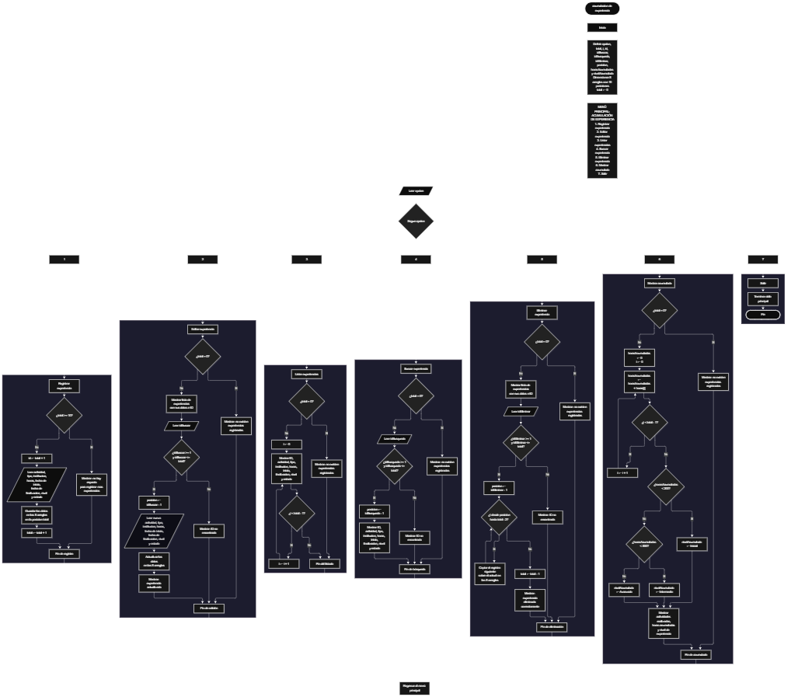

Este proyecto, llamado <b>acumulación de experiencia</b>, fue desarrollado en <b>Java</b> como un ejercicio práctico para fortalecer la lógica de programación mediante la creación de un sistema de gestión de experiencias académicas, laborales o proyectos desde la consola. El programa cuenta con un menú principal de siete opciones que permite <b>registrar, editar, listar, buscar y eliminar experiencias, además de consultar el acumulado de horas realizadas</b>. Cada experiencia almacena información como el nombre de la actividad, el tipo de experiencia, la empresa o institución, la cantidad de horas, las fechas de inicio y finalización, el nivel y el estado, utilizando ocho arreglos paralelos con una capacidad máxima de <b>10 experiencias durante la ejecución</b>. También incorpora un sistema de clasificación que determina el nivel de experiencia alcanzado según las horas acumuladas: inicial, intermedio o avanzado. Durante su desarrollo se aplicaron conceptos fundamentales de programación, como variables, arreglos, estructuras condicionales, ciclos repetitivos y estructuras de selección, además de procesos para buscar, modificar, eliminar y organizar registros. Este proyecto permite poner en práctica los conocimientos adquiridos en Java y sirve como base para desarrollar sistemas de gestión más avanzados utilizando otros lenguajes y tecnologías.

<h2 align="center">⚙️ Funcionamiento del menú principal</h2>

### ➕ Registrar experiencia

La opción <b>1) Registrar experiencia</b> permite almacenar una nueva actividad o proyecto en el sistema. Antes de realizar el registro, el programa comprueba que la cantidad de experiencias almacenadas sea menor a <b>10</b>, utilizando la condición <b>total >= actividades.length</b> para impedir que se agreguen más registros cuando se alcanza la capacidad máxima. Si existe espacio disponible, se genera un identificador mediante la expresión <b>total + 1</b> y se solicita el <b>nombre de la actividad o proyecto, tipo de experiencia, empresa o institución, cantidad de horas realizadas, fecha de inicio, fecha de finalización, nivel de experiencia y estado</b>. Cada dato se almacena en la posición correspondiente de sus respectivos arreglos. Finalmente, aumenta la variable <b>total</b> en uno y muestra el mensaje <b>"Experiencia registrada correctamente."</b>. Si no existe espacio disponible, presenta el mensaje <b>"No hay espacio para registrar mas experiencias."</b> e impide realizar un nuevo registro.

### ✏️ Editar experiencia

La opción <b>2) Editar experiencia</b> permite modificar la información de una experiencia registrada. Primero, el programa comprueba si existen experiencias almacenadas mediante la condición <b>total == 0</b>. Si no hay registros, muestra el mensaje <b>"No existen experiencias registradas."</b>. En caso contrario, utiliza un ciclo <b>for</b> para mostrar una lista con el ID, actividad, tipo, institución, horas, fechas, nivel y estado de cada experiencia. Después, solicita el ID de la experiencia que se desea editar y comprueba que esté dentro del rango permitido mediante la condición <b>idBuscar >= 1 && idBuscar <= total</b>. Si la selección es válida, calcula su posición mediante <b>idBuscar - 1</b> y solicita nuevamente todos los datos de la experiencia, actualizando directamente los valores de los ocho arreglos correspondientes. Finalmente, presenta el mensaje <b>"Experiencia actualizada correctamente."</b>. Si el ID introducido no corresponde a una experiencia registrada, muestra el mensaje <b>"ID no encontrada."</b>.

### 📋 Listar experiencias

La opción <b>3) Listar experiencias</b> permite visualizar todos los registros almacenados actualmente en el sistema. Antes de mostrar la información, el programa comprueba si la variable <b>total</b> es igual a cero. Si no existen experiencias registradas, presenta el mensaje <b>"No existen experiencias registradas."</b>. Si hay registros disponibles, utiliza un ciclo <b>for</b> para recorrer los arreglos desde la primera posición hasta la cantidad total de experiencias almacenadas. Durante el recorrido, muestra el ID, la actividad, el tipo de experiencia, la institución, las horas realizadas, las fechas de inicio y finalización, el nivel y el estado de cada registro. Esta función facilita consultar toda la información existente sin necesidad de buscar cada experiencia individualmente.

### 🔎 Buscar experiencia

La opción <b>4) Buscar experiencia</b> permite localizar una experiencia mediante su ID. Primero, el programa comprueba si existen registros almacenados utilizando la condición <b>total == 0</b>. Si no hay experiencias registradas, muestra el mensaje <b>"No existen experiencias registradas."</b>. En caso contrario, solicita el ID de la experiencia que se desea buscar y verifica que esté dentro del rango válido mediante la condición <b>idBusqueda >= 1 && idBusqueda <= total</b>. Si el ID existe, calcula su posición mediante <b>idBusqueda - 1</b> y muestra todos los datos de la experiencia encontrada: actividad, tipo, institución, horas, fechas, nivel y estado. Si el ID introducido no corresponde a ningún registro existente, presenta el mensaje <b>"ID no encontrada."</b>.

### 🗑️ Eliminar experiencia

La opción <b>5) Eliminar experiencia</b> permite eliminar un registro mediante su ID. Antes de comenzar, el programa comprueba que existan experiencias almacenadas. Si el sistema está vacío, muestra el mensaje <b>"No existen experiencias registradas."</b>. Si hay registros disponibles, presenta una lista con los datos de todas las experiencias. Después, solicita el ID de la experiencia que se desea eliminar y comprueba que la selección esté dentro del rango válido. Si el ID existe, calcula su posición mediante <b>idEliminar - 1</b> y comienza el proceso de eliminación. Para mantener los registros organizados, utiliza un ciclo <b>for</b> que desplaza una posición hacia atrás los datos posteriores en los ocho arreglos: <b>actividades, tipos, instituciones, horas, fechasInicio, fechasFinalizacion, niveles y estados</b>. Posteriormente, disminuye la variable <b>total</b> en uno y muestra el mensaje <b>"Experiencia eliminada correctamente."</b>. Si el ID seleccionado no corresponde a una experiencia registrada, presenta el mensaje <b>"ID no encontrada."</b>.

### 📊 Mostrar acumulado

La opción <b>6) Mostrar acumulado</b> permite consultar un resumen de las experiencias registradas y calcular la cantidad total de horas realizadas. Primero, el programa comprueba si existen experiencias almacenadas. Si no hay registros, muestra el mensaje <b>"No existen experiencias registradas."</b>. En caso contrario, inicializa la variable <b>horasAcumuladas</b> en cero y utiliza un ciclo <b>for</b> para recorrer el arreglo <b>horas</b>, sumando las horas de cada experiencia registrada. Después, mediante estructuras condicionales <b>if, else if y else</b>, determina el nivel de experiencia alcanzado según el total de horas acumuladas. Si el resultado es menor a <b>200 horas</b>, asigna el nivel <b>"Inicial"</b>; si es menor a <b>500 horas</b>, asigna el nivel <b>"Intermedio"</b>; y si alcanza las <b>500 horas o más</b>, asigna el nivel <b>"Avanzado"</b>. Finalmente, muestra la cantidad de actividades realizadas, las horas acumuladas y el nivel de experiencia obtenido.

### 🚪 Salir del menú principal

La opción <b>7) Salir</b> está destinada a finalizar la ejecución del programa y muestra el mensaje <b>"Gracias por utilizar Acumulacion de Experiencia."</b>. El menú principal se encuentra dentro de una estructura repetitiva <b>do-while</b>, que mantiene el programa en funcionamiento mientras el usuario realiza las diferentes operaciones disponibles. La condición de repetición es <b>opcion != 7</b>, por lo que al seleccionar la opción 7 finaliza el ciclo y se ejecuta <b>entrada.close()</b> para cerrar el objeto Scanner utilizado para recibir los datos introducidos por el usuario.

<h2 align="center">🧠 Temas aplicados en el proyecto</h2>

### 📦 Variables

En este proyecto se utilizan variables para controlar la opción seleccionada en el menú, almacenar la cantidad de experiencias registradas, identificar los registros que se desean editar, buscar o eliminar, recorrer los arreglos y calcular las horas acumuladas. También se utilizan variables para determinar el nivel de experiencia alcanzado según el total de horas realizadas. Cada variable cumple una función específica dentro de las operaciones del sistema.

🔢 **Opcion:** Almacena la opción seleccionada por el usuario en el menú principal.

📊 **Total:** Almacena la cantidad actual de experiencias registradas.

🔄 **I:** Funciona como contador en los ciclos `for` y permite recorrer los arreglos para mostrar, calcular y organizar los registros.

🔎 **Id:** Almacena temporalmente el identificador generado para una nueva experiencia.

📝 **IdBuscar:** Almacena el ID introducido por el usuario para seleccionar una experiencia que desea editar.

🔍 **IdBusqueda:** Almacena el ID introducido por el usuario para localizar una experiencia.

🗑️ **IdEliminar:** Almacena el ID de la experiencia que se desea eliminar.

📍 **Posicion:** Permite identificar la posición del registro seleccionado dentro de los arreglos mediante la resta de uno al ID introducido.

⏱️ **HorasAcumuladas:** Almacena la suma total de las horas realizadas en todas las experiencias registradas.

🏷️ **NivelAcumulado:** Almacena la clasificación final de la experiencia según las horas acumuladas: Inicial, Intermedio o Avanzado.

### 🗃️ Arreglos

En este proyecto se utilizan ocho arreglos paralelos para almacenar la información correspondiente a cada experiencia. Cada arreglo tiene una capacidad de <b>10 posiciones</b> y utiliza el mismo índice para representar los datos de un mismo registro. Por ejemplo, la información de una experiencia almacenada en la posición <b>0</b> se encuentra distribuida entre <b>actividades[0], tipos[0], instituciones[0], horas[0], fechasInicio[0], fechasFinalizacion[0], niveles[0] y estados[0]</b>. Esta organización permite recorrer, buscar, modificar, mostrar y eliminar las experiencias de manera ordenada.

📝 **Actividades[10]:** Almacena los nombres de las actividades o proyectos registrados.

📂 **Tipos[10]:** Almacena el tipo de experiencia correspondiente a cada registro.

🏢 **Instituciones[10]:** Almacena los nombres de las empresas o instituciones.

⏱️ **Horas[10]:** Almacena la cantidad de horas realizadas en cada experiencia.

📅 **FechasInicio[10]:** Almacena las fechas de inicio de las experiencias.

📅 **FechasFinalizacion[10]:** Almacena las fechas de finalización de las experiencias.

🏷️ **Niveles[10]:** Almacena el nivel de experiencia registrado para cada actividad.

📌 **Estados[10]:** Almacena el estado correspondiente a cada experiencia.

### 🔀 Estructuras condicionales

En este proyecto se utilizan las estructuras <b>if, else if y else</b> para comprobar si existen experiencias registradas antes de realizar determinadas operaciones, verificar que haya espacio disponible para agregar nuevos registros, validar los ID introducidos durante la edición, búsqueda y eliminación, y determinar el nivel de experiencia según las horas acumuladas. Estas condiciones permiten que el programa responda de manera diferente dependiendo de la información almacenada y de las decisiones tomadas por el usuario.

### 🔄 Estructuras repetitivas

En este proyecto se utilizan los ciclos <b>for</b> y <b>do-while</b>. Los ciclos <b>for</b> permiten recorrer los arreglos para mostrar las experiencias registradas, calcular las horas acumuladas y desplazar los datos durante la eliminación de un registro. Por otro lado, el ciclo <b>do-while</b> mantiene activo el menú principal y permite que el usuario realice diferentes operaciones hasta seleccionar la opción de salida.

### 🎯 Estructura switch-case

El programa evalúa el valor almacenado en la variable <b>opcion</b> mediante la estructura <b>switch-case</b> y ejecuta el bloque de instrucciones correspondiente. Cada caso representa una operación específica del sistema: <b>registrar, editar, listar, buscar, eliminar, mostrar acumulado o salir</b>. También se utiliza el bloque <b>default</b> para mostrar el mensaje <b>"Opcion no valida."</b> cuando el usuario introduce un número que no corresponde a ninguna de las opciones definidas en el menú.

### 🔢 Dimensionamiento de arreglos

En este proyecto se utiliza la creación de arreglos mediante la instrucción <b>new</b> para establecer la capacidad de los espacios destinados a almacenar la información de las experiencias. Se definieron <b>10 posiciones</b> para cada uno de los ocho arreglos. La cantidad de registros ocupados se controla mediante la variable <b>total</b>, por lo que las operaciones recorren únicamente las posiciones correspondientes a las experiencias registradas durante la ejecución del programa.

### 🔄 Reorganización de registros

Cuando se selecciona una experiencia para eliminarla, el programa utiliza un ciclo <b>for</b> que comienza en la posición seleccionada y continúa hasta <b>total - 1</b>. En cada repetición, los datos de la posición siguiente se copian sobre la posición actual en los ocho arreglos. Después, la variable <b>total</b> disminuye en uno. De esta manera, las experiencias posteriores ocupan las posiciones disponibles sin dejar espacios vacíos entre los registros activos. Los identificadores se muestran nuevamente según la posición que ocupa cada experiencia en la lista.

### 🧮 Acumulación y clasificación de horas

El programa incorpora un procedimiento para calcular la cantidad total de horas realizadas en las experiencias registradas. Para ello, utiliza la variable <b>horasAcumuladas</b>, que comienza en cero y recibe la suma de los valores almacenados en el arreglo <b>horas</b> mediante un ciclo <b>for</b>. Una vez calculado el resultado, se utilizan condiciones para clasificar la experiencia en tres niveles: <b>Inicial</b>, cuando el acumulado es inferior a 200 horas; <b>Intermedio</b>, cuando se encuentra entre 200 y 499 horas; y <b>Avanzado</b>, cuando alcanza o supera las 500 horas. Esta funcionalidad permite obtener un resumen general de las actividades realizadas.

<h2 align="center">¿Cómo se implementaron las operaciones CRUD en el proyecto?</h2>

Las operaciones <b>CRUD</b> se implementaron mediante las opciones del menú principal, permitiendo administrar las experiencias registradas. La operación <b>crear</b> corresponde a <b>Registrar experiencia</b>, donde se introducen los datos de una nueva actividad o proyecto; <b>leer</b> se realiza mediante las opciones <b>Listar experiencias y Buscar experiencia</b>, que permiten consultar los registros almacenados; <b>actualizar</b> corresponde a <b>Editar experiencia</b>, donde se modifican los datos de una experiencia existente; y <b>eliminar</b> se realiza mediante la opción <b>Eliminar experiencia</b>, que retira un registro y reorganiza los datos restantes. Estas operaciones utilizan variables, arreglos, condicionales y ciclos para gestionar la información almacenada temporalmente durante la ejecución del programa. La opción <b>Mostrar acumulado</b> complementa las operaciones CRUD al calcular las horas realizadas y determinar el nivel de experiencia alcanzado.

<h2 align="center">Diagrama de flujo del proyecto</h2>

<h2 align="center">🛡️ Validaciones del programa</h2>

### 📭 No existen experiencias registradas

Esta validación se utiliza en las opciones de <b>editar, listar, buscar, eliminar y mostrar acumulado</b>. El programa comprueba si la variable <b>total</b> es igual a <b>0</b> y, si no existen experiencias registradas, muestra el mensaje <b>"No existen experiencias registradas."</b>. Esta comprobación evita continuar con las operaciones que necesitan información almacenada cuando el sistema está vacío.

### ⚠️ Capacidad máxima alcanzada

Esta validación se utiliza durante el registro de nuevas experiencias para controlar la capacidad máxima de los arreglos. El programa comprueba si <b>total >= actividades.length</b> antes de permitir agregar un nuevo registro. Si se alcanza la capacidad de <b>10 experiencias</b>, muestra el mensaje <b>"No hay espacio para registrar mas experiencias."</b> e impide realizar otro registro mientras no exista espacio disponible.

### 🔢 ID de experiencia no encontrado

Esta validación se utiliza durante las operaciones de <b>editar, buscar y eliminar</b>. El programa comprueba que el ID introducido sea mayor o igual a <b>1</b> y menor o igual al valor de <b>total</b>. Si el identificador se encuentra dentro del rango permitido, calcula la posición correspondiente restando uno al ID. Si no cumple esta condición, muestra el mensaje <b>"ID no encontrada."</b>, evitando acceder a una posición que no corresponde a una experiencia registrada.

### ⏱️ Clasificación de horas acumuladas

Esta clasificación se realiza durante la opción <b>Mostrar acumulado</b>. El programa utiliza las condiciones <b>horasAcumuladas &lt; 200</b>, <b>horasAcumuladas &lt; 500</b> y el bloque <b>else</b> para determinar el nivel alcanzado. De esta manera, asigna el nivel Inicial, Intermedio o Avanzado según la cantidad total de horas realizadas. Esta clasificación se calcula a partir de las horas almacenadas y no modifica los niveles individuales registrados en el arreglo <b>niveles</b>.

### ⚠️ Opción inválida

La estructura <b>switch-case</b> incluye el bloque <b>default</b>, que muestra el mensaje <b>"Opcion no valida."</b> cuando el usuario introduce un número que no corresponde a ninguna de las opciones definidas en el menú principal. Esta comprobación permite informar al usuario cuando selecciona una opción no disponible.

<h2 align="center">🎯 Objetivo del proyecto</h2>

El objetivo principal de este proyecto es fortalecer la <b>lógica de programación</b> mediante el desarrollo de un sistema de gestión de experiencias en <b>Java</b>. A través de su construcción se busca aplicar los conocimientos adquiridos sobre variables, arreglos, estructuras condicionales, ciclos repetitivos y estructuras de selección, integrándolos para resolver un problema de manera organizada. Además, el proyecto permite comprender cómo registrar, consultar, modificar y eliminar información mediante arreglos paralelos, así como realizar operaciones de acumulación y clasificación de datos. De esta manera, se establece una base para desarrollar sistemas de gestión más completos utilizando otros lenguajes y tecnologías.

